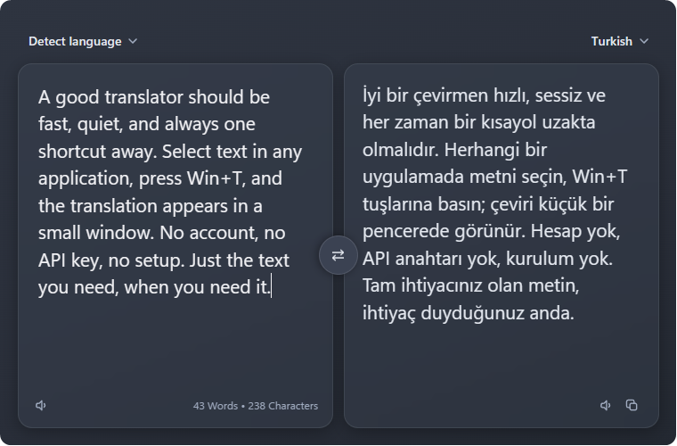
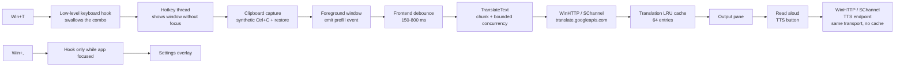

<div align="center">


<h1>translate-wails</h1>

<p><strong>Press <code>Win+T</code>. Get a translation.</strong></p>

[](https://www.microsoft.com/windows)
[](go.mod)
[](https://wails.io)
[](#privacy)
[](LICENSE)

</div>

A Windows-only desktop translator built with Wails v2 and Go. Select text in any application, press `Win+T`, and it is captured, translated, and shown in a small frameless window — no account, API key, or first-run setup. The keyless Google Translate endpoint does the work, and the resulting executable is a single file of about 11 MB.

The UI is deliberately small: two language dropdowns, an input pane, an output pane, and two settings. Labels are in English. It is meant for quick lookups while you work, not for document editing.

<p align="center">
  
</p>

<p align="center"><sub>The main window in the Default theme.</sub></p>

## Features

| | |
|---|---|
| **Global hotkey** | `Win+T` works from any application, captures the current selection, and opens the translator with the text already translating. |
| **Live translation** | Typing translates automatically after a 300 ms debounce (adjustable). |
| **Languages** | 194 selectable languages, plus automatic source detection. Defaults: Detect language → Turkish. |
| **Language-aware swap** | Swaps the language pair and moves the translation into the input. If the source is Detect language, the detected language becomes the new target. |
| **Long text** | Text is split at sentence boundaries into 1,200-rune chunks; the first is translated alone (for stable language detection), the rest three at a time, then reassembled in order. |
| **Read aloud** | Text-to-speech on both panes through the same keyless Google TTS endpoint, with local `speechSynthesis` as a fallback. |
| **Caches** | A 64-entry LRU in Go and a 40-entry result cache in the frontend. Repeated translations paint instantly without a request. |
| **Themes** | Default, Tokyo Night, Catppuccin, Dracula, Nord, Gruvbox, and One Dark. |
| **Unobtrusive window** | Fixed 760×500 frameless window, no taskbar button, single-instance lock, rounded corners on Windows 11. |

Selection capture is capped at 5,000 characters. Long input is capped at 60 chunks (72,000 runes).

## Hotkeys

| Shortcut | Scope | Action |
|---|---|---|
| `Win+T` | Global, while the app is running | Show the window and capture the current selection. If nothing is selected, the previous input is kept. |
| `Win+,` | Translator focused | Toggle the settings panel. Passed through to Windows in every other app. |
| `Esc` | Translator focused | Close settings, then a language menu, then stop speech; otherwise hide the window. |

> `Win+T` is globally captured while translate-wails is running, so the shell's own `Win+T` (taskbar cycling) is unavailable. Closing the app restores normal Windows behavior.

The app has no tray icon and starts hidden. To quit, focus the window with `Win+T`, then press `Alt+F4` (or end the process from Task Manager). `Esc` only hides it.

## Requirements

- **Windows 10 or 11** (64-bit). Rounded corners require Windows 11; on Windows 10 the window is square.
- **Microsoft Edge WebView2 Runtime** — included with Windows 11, may need to be installed on Windows 10.
- **Go 1.25 or newer** — `go.mod` targets Go 1.25.0.
- **Wails v2 CLI** — the project uses Wails v2.15.0.
- **Node.js and npm** — used to build the frontend.

No CGO or gcc toolchain is required. The Windows integration uses `golang.org/x/sys/windows` and `syscall` only.

## Getting started

### Download

Grab the latest `translate-wails.exe` from [Releases](https://github.com/muradcift/translate-wails/releases/latest) and run it. It is a single portable executable; no installer is required.

### Build from source

```bash
git clone https://github.com/muradcift/translate-wails.git
cd translate-wails

go install github.com/wailsapp/wails/v2/cmd/wails@v2.15.0

wails build
```

The executable is written to `build/bin/translate-wails.exe`. Launch it; the window stays hidden until you press `Win+T`.

For development with frontend hot reload:

```bash
wails dev
```

Use `wails build` for a real build. A plain `go build` does not run the frontend build, and `frontend/dist` is not committed, so it is not a supported build path from a fresh clone.

## Usage

1. Start `translate-wails.exe`. Nothing appears; the app is waiting in the background.
2. Select text in any application — browser, editor, terminal, PDF reader.
3. Press `Win+T`. The translator appears, and the selection is captured through a synthetic `Ctrl+C` and placed in the input pane.
4. The translation starts automatically. Keep typing or editing to translate again after the debounce.
5. Use the swap button to reverse the direction, the copy button to copy the result, or the speaker buttons to read either pane aloud.
6. Press `Esc` to hide the window. The next `Win+T` brings it back.

For normal use without a selection, open the window with `Win+T` and type or paste directly into the input pane. Translation runs on the same debounce.

The clipboard is restored after capture, so the selection does not stay in your clipboard. The window is shown without stealing focus while the copy is sent, which is why capture still reaches the application you were using.

## Settings

Open the panel with `Win+,` while the translator is focused. It is a centered overlay in the same window.

| Setting | Options | Default |
|---|---|---|
| Debounce | 150 ms, 300 ms, 500 ms, 800 ms | 300 ms |
| Theme | Default, Tokyo Night, Catppuccin, Dracula, Nord, Gruvbox, One Dark | Default |

Both settings persist in `localStorage` under the key `settings` and are restored on the next launch. There are no other preferences.

## How it works

The backend is Go; the frontend is plain JavaScript built with Vite and rendered in WebView2. Wails binds three methods: `TranslateText`, `CopyText`, and `SpeakTTS`.



**Why a keyboard hook?** Windows and the shell reserve `Win+T`; `RegisterHotKey` fails with "already registered" on most machines. A low-level keyboard hook therefore swallows the combination before the shell sees it, posts a message to a dedicated hotkey thread, and masks the Win key-up so the Start menu does not open. `Win+,` is only intercepted while the translator is in the foreground, so desktop peek is untouched elsewhere.

**Capture order matters.** The selection is copied while the previous application is still focused, then the window is shown and foregrounded, and finally the text is sent to the frontend. Reversing that order would send `Ctrl+C` to the translator itself. A 1.2-second deadline keeps a slow clipboard owner from blocking the window.

**Transport.** Requests go through WinHTTP with the OS TLS stack (SChannel), with Go's `net/http` as a fallback. One session and one connection per host are cached and reused. Long queries switch from GET to form-encoded POST once the URL would exceed 1,800 bytes.

**Failure handling.** A `429` pauses all translation and TTS requests behind a shared cooldown (2 seconds by default, up to 8) and jitters wake-ups; translation chunks retry twice (500 ms, then 1,200 ms). The frontend also raises its soft 250 ms request floor to 1,200 ms after a rate limit, steps down to 600 ms, and returns to 250 ms after four successful calls.

## Performance

Measured by the author on a five-chunk request: serial translation with a fixed delay between chunks took **3,999 ms**; first-chunk-then-parallel translation with concurrency 3 took **384 ms**, a **10.4×** improvement. Cached window handles, faster clipboard polling, and the two result caches further reduce per-hotkey and per-keystroke work.

The full measurements, including caveats about network variance, are in [PERFORMANCE-NOTES.md](PERFORMANCE-NOTES.md).

## Troubleshooting

| Symptom | Cause and fix |
|---|---|
| **"Rate limited by Google. Wait a moment and try again."** | The keyless endpoint is throttling requests. The app pauses all requests briefly and retries automatically; if it persists, wait a minute and slow down. |
| **Windows SmartScreen warning** | The executable is not code-signed. Choose **More info → Run anyway**, or build it yourself. |
| **Blank window / WebView2 error** | Install the Microsoft Edge WebView2 Runtime, then restart the app. |
| **`Win+T` does nothing** | Make sure the app is running. Games, keyboard remappers, and other global-hook tools can interfere. Closing the app returns `Win+T` to Windows. |
| **`Win+,` does nothing** | It only works while the translator window has focus. |
| **TTS uses a different voice** | The Google TTS request failed or was throttled. The app falls back to a local `speechSynthesis` voice and says so in the status line. |
| **"Text is too long"** | Input is limited to 60 chunks of 1,200 runes (72,000 runes). Shorten the text. |
| **No close button** | The window is frameless by design. Press `Alt+F4` while it is focused, or end the process from Task Manager. |

## Privacy

- No telemetry, analytics, accounts, or background services.
- Settings live in WebView2's `localStorage` on your machine.
- The clipboard is read only during a `Win+T` capture. The previous text is restored afterwards; non-text clipboard formats (images, file lists) may be dropped on that path.
- The only network destination is `translate.googleapis.com`, over HTTPS, for translation and TTS. The text you translate is necessarily sent there.
- No update checker and no remote configuration.

## Limitations & disclaimer

- **Windows only.** The window management, hotkey, clipboard, and transport code are Win32-specific.
- **Unofficial endpoint.** The keyless Google endpoint can rate-limit, change, or stop working without notice. There is no API contract or SLA.
- **Not affiliated with Google.** Google Translate is a trademark of Google LLC.
- **Unsigned binary.** Windows may warn on first launch.
- **Global shortcut takeover.** While the app runs, `Win+T` belongs to it, not to the Windows shell.
- **Selection capture depends on `Ctrl+C`.** Applications that do not support the copy shortcut, or windows that cannot receive synthetic input, will not provide a selection.
- Provided as-is, without warranty. Use at your own risk.

## Contributing

Issues and pull requests are welcome. Before opening a PR:

```bash
go vet ./...
wails dev
```

There is no automated test suite and no CI; changes are checked manually with `wails build` and by exercising the hotkey flow. Please keep new dependencies CGO-free, and keep the hotkey path clipboard-based — UI Automation was removed because it could wedge the process.

Performance work and measurements are documented in [PERFORMANCE-NOTES.md](PERFORMANCE-NOTES.md).

## License

MIT — see [LICENSE](LICENSE).
